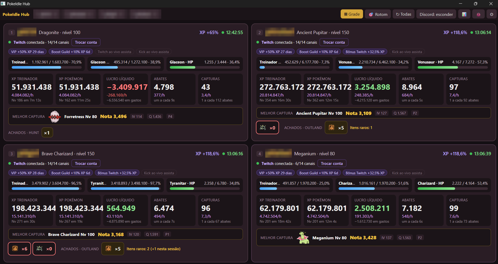

<div align="center">

# 🎮 PokeIdle Hub

**Suas contas do PokéIdle numa janela só — leve, sempre ligadas e com os bônus da Twitch rodando sozinhos.**

[](https://github.com/sourafaelads/pokeidle/releases/latest)




[⬇️ Baixar](#%EF%B8%8F-como-baixar-e-instalar) · [🚀 Primeiro uso](#-primeiro-uso) · [💜 Bônus da Twitch](#-como-funcionam-os-bônus) · [❓ Dúvidas](#-dúvidas-frequentes) · [🐞 Bugs e ideias](#-bugs-e-ideias)

</div>

---

## ✨ O que ele faz

Quem joga com várias contas sabe: 4 abas do jogo + 7 lives da Twitch abertas no navegador = PC pesado, abas que congelam e live que cai no meio da noite. O **PokeIdle Hub** resolve isso:

| | |
|---|---|
| 🪟 **Até 4 contas numa janela** | O máximo permitido pelas regras do jogo. Cada conta com o próprio login, fora do seu navegador do dia a dia. O nome da aba vira o nick da conta. |
| 🪶 **Leve de verdade** | Feito em Rust, com o motor do Edge que já vem no Windows. Usa uma fração da RAM de um navegador com tudo aberto. |
| 💤 **Nunca congela** | As contas continuam rodando mesmo minimizadas ou fora da tela. Dá para deixar a noite toda. |
| 💜 **Bônus da Twitch sem abrir live** | O app entra no **chat** das lives parceiras com a Twitch de cada conta. Sem vídeo, sem áudio, quase zero de RAM. |
| ▦ **Painel em grade** | As 4 contas lado a lado: XP/h, lucro/h, abates, capturas, "upa em X min", bônus ativos, melhor captura, itens e drops raros. |
| 🎯 **Extensões** | Carrega a **/hunt for PokeIdle** e a **Rotom Sniper** (Cockpit no botão 🎯 ou `Ctrl+P`). |
| 🎮 **Discord** | Mostra no seu perfil o Pokémon em campo, nível, onde está caçando e o tempo de sessão. |
| 🔔 **Avisos** | Drop raro novo (★), conta derrubada (⚠), conta repetida em duas abas e versão nova do app. |

---

## 🪶 Feito para PC fraco

Esse é o objetivo número 1 do projeto: **rodar as 4 contas + os bônus num PC simples sem travar o resto**. Por isso ele é feito em Rust (sem Electron, sem Chrome embutido) e usa o motor do Edge que já vem no Windows, com um único motor dividido entre todas as contas.

### Antes × depois (medido no PC do autor)

Mesmo cenário nos dois casos: **4 contas do jogo + bônus da Twitch de 7 lives**, medido no Gerenciador de Tarefas, num PC com 14 GB de RAM.

| | Navegador (Brave) | **PokeIdle Hub** |
|---|---|---|
| **RAM** | ~5,7 GB | **~0,9 a 1 GB** |
| **CPU** | 100% da referência | **~93% a menos** |
| **Lives da Twitch** | 7 abas com vídeo e áudio | **0 abas** — só o chat (poucos MB no total) |
| **Abas congelando / live caindo de madrugada** | sim | **não** (o app reconecta sozinho) |

```
RAM   Brave (4 contas + 7 lives)  ████████████████████████████  ~5,7 GB
      PokeIdle Hub                █████                         ~1 GB
```

**Por que fica tão leve**

- **Twitch sem vídeo:** em vez de abrir a live, o app entra só no chat. É o que conta para o bônus, e custa quase nada.
- **Um motor só:** as 4 contas dividem o mesmo motor (cada uma com o próprio login), em vez de 4 navegadores.
- **Conta fora da vista não desenha:** o jogo continua rodando, mas sem gastar CPU/GPU pintando a tela.
- **Grade leve:** o painel lê só os números do jogo, em vez de mostrar 4 jogos encolhidos.

### Versão padrão × versão com Kick

| | `PokeIdleHub.exe` (padrão) | `PokeIdleHub-Kick.exe` |
|---|---|---|
| Para quem | **todo mundo** — recomendada | quem também quer o bônus da Kick |
| Twitch | ✅ pelo chat (quase zero de RAM) | ✅ pelo chat (quase zero de RAM) |
| Kick | — | ✅ abre **1 live escondida e sem som por conta** |
| RAM a mais | — | **~500 MB por live da Kick** (com 4 contas, ~2 GB a mais) |
| PC fraco | ✅ ideal | ⚠️ só se sobrar memória |

> A Kick não tem um jeito leve de "assistir" como o chat da Twitch — o vídeo precisa estar aberto. Por isso ela fica numa versão separada: quem não usa não paga o custo.

---

## ⬇️ Como baixar e instalar

1. Vá em **[Releases](https://github.com/sourafaelads/pokeidle/releases/latest)** e baixe o arquivo **`.zip`** da versão mais nova.
2. **Extraia** o zip numa pasta (ex.: `Documentos\PokeIdle Hub`). Não rode de dentro do zip.
3. Abra o **`PokeIdleHub.exe`**.

> [!NOTE]
> **O Windows avisou "O Windows protegeu o computador"?** É normal em programas novos que ainda não têm assinatura paga. Clique em **Mais informações → Executar assim mesmo**. O código está todo aqui no repositório para quem quiser conferir.

**O que vem no zip**

| Arquivo | Para que serve |
|---|---|
| `PokeIdleHub.exe` | O app (versão principal) |
| `PokeIdleHub-Kick.exe` | Mesma coisa + lives da Kick (pesa ~500 MB a mais por live — só se você precisar) |
| `WebView2Loader.dll` | Precisa ficar **na mesma pasta** do .exe |
| `LEIA-ME.txt` | Guia rápido |

> [!WARNING]
> Nunca abra o `PokeIdleHub.exe` e o `PokeIdleHub-Kick.exe` ao mesmo tempo — eles usam os mesmos logins.

**Requisitos:** Windows 10 ou 11 (o motor WebView2 já vem instalado; se faltar, o Windows baixa sozinho pelo Edge).

---

## 🚀 Primeiro uso

1. **Faça login em cada aba** (1 a 4). Espere o ✓ da Cloudflare aparecer antes de clicar em *Entrar*.
   Cada aba precisa de uma **conta diferente** — se duas abas usarem a mesma conta, uma derruba a outra.
2. Abra a **▦ Grade** e, em cada cartão, clique em **Conectar Twitch** e entre com a Twitch **daquela conta** (veja abaixo).
3. Pronto. Da próxima vez, tudo abre e conecta sozinho — os logins ficam salvos no seu PC.

---

## 💜 Como funcionam os bônus

### Twitch (o principal)

O PokéIdle dá **% a mais de XP** para quem está assistindo às lives parceiras — e cada live parceira ao vivo soma mais bônus. Normalmente isso exige deixar várias lives abertas no navegador, o que pesa muito.

O PokeIdle Hub faz diferente: ele **entra no chat** das lives com a sua conta da Twitch, como se você estivesse com a live aberta, mas **sem baixar vídeo nem áudio**. São só algumas conexões de texto — praticamente não gasta nada.

```
 Conta do jogo  ──vinculada no jogo──▶  Conta da Twitch  ──o app entra no chat──▶  lives parceiras
     (phl...)                              (sua twitch)                              💜 +% XP
```

**Para o bônus contar, a regra é uma só:**

> A conta da Twitch que você conecta no cartão da Grade tem que ser **a mesma que está vinculada àquela conta dentro do jogo**.

| Situação | Resultado |
|---|---|
| Conta 1 vinculada à Twitch *A* e o app conectado com *A* | ✅ Bônus Twitch ativo |
| Conta 1 vinculada à Twitch *A* e o app conectado com *B* | ❌ "Twitch ao vivo · assista" (sem bônus) |
| Duas contas usando a mesma Twitch | ⚠️ Só uma recebe o bônus |

- Onde ver o vínculo: dentro do jogo, na área de bônus da Twitch aparece **"Conta vinculada: …"**.
- Para trocar: no cartão da conta na Grade, clique em **Trocar conta**.
- O jogo leva **alguns minutos** para reconhecer. Quando reconhecer, aparece o chip **"Bônus Twitch +X% XP"** no cartão.
- O cartão mostra quantos canais estão conectados (ex.: **14/14 canais**).

### Kick (opcional)

Só no `PokeIdleHub-Kick.exe`. A Kick não tem um "chat leve" como a Twitch, então o app precisa abrir uma live de verdade (escondida e sem som) — por isso pesa bem mais. Ele abre **1 live por conta** (a parceira que estiver ao vivo). Vincule a Kick dentro do jogo em *Bônus na Kick*.

### VIP, Boost de Guild e outros

Esses são do próprio jogo. O app só **mostra** quais estão ativos e quanto tempo falta, no cartão de cada conta.

---

## 🧭 A barra de cima

| Botão | O que faz |
|---|---|
| **1 · 2 · 3 · 4** | Troca de conta. Duplo clique renomeia. **↻** recarrega só aquela conta. |
| **▦ Grade** | Painel com todas as contas lado a lado. Clique num cartão para abrir a conta. |
| **🎯 Rotom** | Abre o Cockpit da Rotom Sniper da conta aberta. |
| **↻ Todas** | Recarrega todas as contas. |
| **Discord: …** | Como seu nick aparece no Discord: *mostrar*, *borrar* ou *esconder*. |
| **📊** | RAM e CPU de cada página. |
| **🐞** | Salva uma cópia da página para diagnóstico (para mandar em caso de bug). |
| **⚙** | Abre a pasta de configuração. |

### ⌨️ Atalhos

| Atalho | Ação |
|---|---|
| `Ctrl` + `1`…`4` | Trocar de conta |
| `Ctrl` + `G` | Grade |
| `Ctrl` + `P` | Rotom Sniper |
| `F12` | Ferramentas de desenvolvedor |

---

## 🧩 Extensões (/hunt e Rotom Sniper)

O app usa as extensões que **já estão instaladas** no seu Brave, Chrome ou Edge:

1. Instale no seu navegador: [/hunt for PokeIdle](https://chromewebstore.google.com/detail/mhnplloljgchpfpcpbhmcokmnefodjnh) e [Rotom Sniper](https://chromewebstore.google.com/detail/olccbpdjdkbfgondiiaicmlifhbcggmk).
2. Feche e abra o PokeIdle Hub. Ele copia e carrega nas 4 contas.

Quando a extensão atualizar no navegador, o app pega a versão nova na próxima vez que abrir.

---

## 🎮 Discord

Com o Discord aberto no PC, aparece no seu perfil **"Jogando Idle Hub"** com:
- o **seu Pokémon em campo** (sprite animado), nick e nível;
- onde está caçando e contra quem;
- o **tempo da sessão**.

Com várias contas, ele alterna entre elas a cada minuto. Não quer mostrar o nick? Clique em **Discord:** na barra até ficar *borrar* ou *esconder*.

---

## ⚙️ Configurações (`config.json`)

Clique em **⚙** para abrir a pasta. **Feche o app antes de editar.**

| Opção | Padrão | O que faz |
|---|---|---|
| `contas` | `["Conta 1", …]` | Nomes das abas (com "Conta N", usa o nick do jogo) |
| `canais` | lives parceiras | Canais da Twitch (os padrão são somados sozinhos) |
| `discord` | `true` | Mostrar no Discord |
| `discord_nick` | `"mostrar"` | `"mostrar"`, `"borrar"` ou `"esconder"` |
| `discord_emoji` | `"🧢"` | Emoji antes do nick (`""` = nenhum) |
| `discord_intervalo` | `60` | Segundos para alternar de conta no Discord |
| `pausar_desenho` | `true` | Contas fora da vista não desenham (menos CPU) |
| `memoria_baixa` | `false` | Enxuga a memória das contas fora da vista |
| `mostrar_insta` | `true` | Botão do Instagram do autor na barra |
| `repo_github` | `sourafaelads/pokeidle` | Onde procurar versão nova (`""` = não procurar) |
| `kick_max` | `1` | Lives da Kick por conta (só na versão Kick) |

---

## 🔒 Seus dados

- **A senha não é salva.** O app guarda só a sessão (cookies), igual a um navegador, em `%LOCALAPPDATA%\PokeIdleHub\`.
- **Não compartilhe essa pasta** — quem tiver ela entra logado nas suas contas.
- Para passar o app para um amigo, mande só o **zip da Release** (ou o .exe + .dll).
- O app não envia nada para servidor nenhum. Ele só fala com o jogo, a Twitch, o Discord do seu PC e, ao abrir, olha se há versão nova aqui no GitHub.

---

## ❓ Dúvidas frequentes

<details>
<summary><b>O bônus da Twitch não aparece numa conta</b></summary>

Quase sempre é a Twitch errada. Confira no jogo qual Twitch está vinculada àquela conta e use **Trocar conta** no cartão da Grade para entrar com ela. Duas contas do jogo não podem usar a mesma Twitch. Depois espere alguns minutos.
</details>

<details>
<summary><b>Aparece "Conta aberta em outro lugar"</b></summary>

A mesma conta do jogo está logada em duas abas (ou no app e no navegador ao mesmo tempo). Deixe cada conta em um lugar só. O cartão da Grade avisa quando duas abas estão com a mesma conta.
</details>

<details>
<summary><b>Ficou preso na tela da Cloudflare</b></summary>

Espere o ✓ aparecer sozinho antes de clicar em qualquer coisa. Se travar, clique no **↻** da aba.
</details>

<details>
<summary><b>Quero deixar ligado a noite toda</b></summary>

No Windows: **Configurações → Sistema → Energia → Suspender quando conectado: Nunca**. O app continua rodando com a tela desligada.
</details>

<details>
<summary><b>A extensão não aparece</b></summary>

Ela precisa estar instalada no Brave, Chrome ou Edge. Instale, feche e abra o app de novo.
</details>

<details>
<summary><b>Como fico sabendo de versão nova?</b></summary>

Ao abrir, o app consulta este repositório. Se tiver versão nova, aparece o botão verde **⬆ Nova versão** na barra. Também dá para clicar em **Watch → Custom → Releases** aqui no GitHub para receber e-mail.
</details>

---

## 🛠️ Compilar a partir do código

Precisa do [Rust](https://rustup.rs) no Windows.

```bash
git clone https://github.com/sourafaelads/pokeidle
cd pokeidle
cargo build --release                 # versão principal
cargo build --release --features kick # versão com Kick
```

O executável sai em `target\release\pokeidle-hub.exe`. Copie o `WebView2Loader.dll` da Release para a mesma pasta.

**Estrutura**

```
src/main.rs      janela, abas, grade, extensões e atalhos
src/twitch.rs    conexão leve ao chat da Twitch (IRC sobre TLS)
src/discord.rs   Rich Presence pelo IPC local do Discord
vendor/wry/      wry 0.53 com pequenos ajustes para o WebView2
                 (perfis por conta, extensões, memória, gerenciador de tarefas)
```

Quer mandar código? Leia o [guia de contribuição](CONTRIBUTING.md).

---

## 🐞 Bugs e ideias

Achou um problema ou tem uma ideia? Abra uma issue — leva 1 minuto:

<div align="center">

[](https://github.com/sourafaelads/pokeidle/issues/new?template=bug.yml)
[](https://github.com/sourafaelads/pokeidle/issues/new?template=ideia.yml)

</div>

No bug, cole o final do `log.txt` (fica ao lado do .exe) — ajuda muito a achar o problema.

---

## ⚠️ Aviso

Projeto de fã, **sem ligação oficial com o PokéIdle**. O app não altera o jogo: ele só abre as páginas, lê o que aparece na tela e entra nos chats da Twitch com a sua conta. Use com bom senso e respeite as regras do jogo.

---

<div align="center">

Feito por **Rafael** · se o app te ajudou, me segue no Instagram 💜

[](https://www.instagram.com/sourafaelads/)

Licença [MIT](LICENSE) — use, modifique e compartilhe à vontade.

</div>
